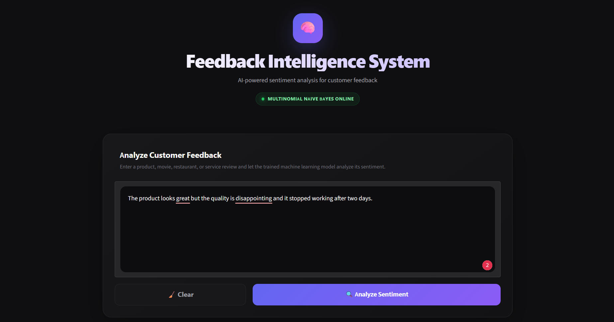
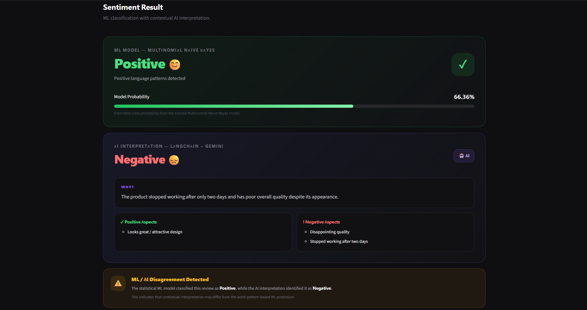
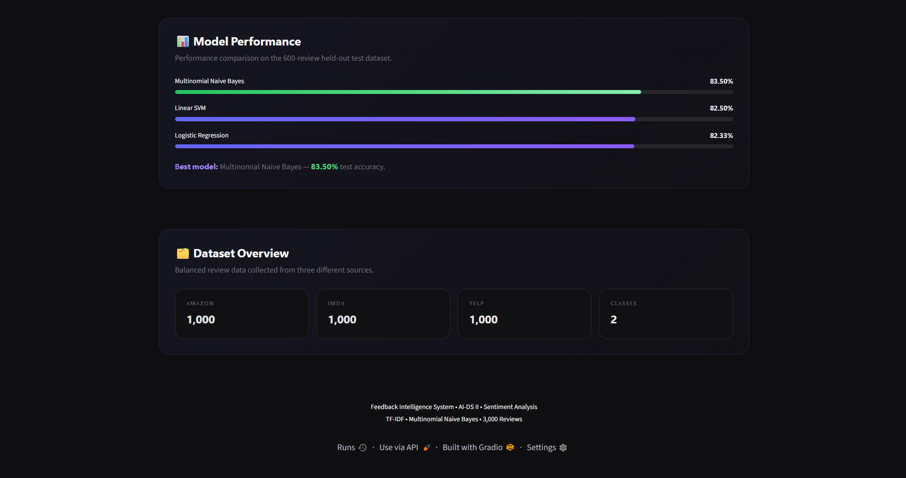

# Feedback Intelligence System

A sentiment analysis project that combines traditional machine learning
with LLM-based contextual interpretation to analyze customer reviews.

## Project Overview

The system classifies customer feedback using TF-IDF features and a
Multinomial Naive Bayes model. An optional Gemini-powered analysis,
integrated through LangChain, provides contextual explanations and
extracts positive and negative aspects from a review.


## Application Screenshots

### Main Dashboard


### AI-Powered Review Interpretation


### Model Comparison


### Key Features

-   Text cleaning and preprocessing
-   Exploratory data analysis (EDA)
-   TF-IDF features using unigrams and bigrams
-   Comparison of Multinomial Naive Bayes, Logistic Regression, and
    Linear SVM
-   Gradio interface for interactive sentiment analysis
-   Optional LLM interpretation using Gemini and LangChain
-   Comparison of the ML prediction with the LLM interpretation

## Dataset

This project uses the **Sentiment Labelled Sentences** dataset from the
UCI Machine Learning Repository. It contains 3,000 labelled sentences
from Amazon, IMDb, and Yelp (1,000 from each source).

-   Source:
    https://archive.ics.uci.edu/dataset/331/sentiment+labelled+sentences
-   DOI: https://doi.org/10.24432/C57604
-   License: CC BY 4.0, as stated on the UCI dataset page

Retain the original attribution and check the source page for applicable
terms when redistributing the dataset. If you use a modified or
separately downloaded copy, verify that it is the same dataset/version.

Suggested citation: Kotzias, D. (2015). *Sentiment Labelled Sentences*
[Dataset](#dataset). UCI Machine Learning Repository.
https://doi.org/10.24432/C57604.

## Model Results

The data was split using an 80/20 stratified train/test split:

-   Training set: 2,400 reviews
-   Test set: 600 reviews

  Model                       Test accuracy
  ------------------------- ---------------
  Multinomial Naive Bayes            83.50%
  Linear SVM                         82.50%
  Logistic Regression                82.33%

Multinomial Naive Bayes was selected as the primary ML model because it
achieved the highest test accuracy in this experiment. The LLM output is
intended as contextual interpretation, not as a proven improvement in
classification accuracy. The reported 83.50% is the ML model's measured
test accuracy; no separate quantitative accuracy claim is made for the
LLM or hybrid workflow.

## Project Structure

Suggested repository structure:

``` text
Feedback-Intelligence-System/
├── README.md
├── requirements.txt
├── .gitignore
├── Feedback_Intelligence_Sentiment_Analysis.ipynb
├── app.py                         # Include if the Gradio app is saved separately
└── dataset/                       # Include only if permitted and needed
```

The notebook may also create `dataset/`, `models/`, and `notebooks/`
folders in Google Drive. Update `PROJECT_PATH` in the notebook to your
own mounted Drive folder before running it.

## Setup

### 1. Get the project

Download or clone this repository.

### 2. Install dependencies

Use a Python version compatible with the installed packages.

``` bash
pip install -r requirements.txt
```

### 3. Configure the project path

In Google Colab, mount Google Drive first and set `PROJECT_PATH` to your
own project folder, for example:

``` python
PROJECT_PATH = "/content/drive/MyDrive/Feedback-Intelligence-System"
```

Replace the example with your own path. Make sure Google Drive is
mounted before running cells that read or write files at that location.

### 4. Configure Gemini (optional)

The LLM-based analysis requires a Gemini API key. Create your own key
through Google AI Studio and provide it through the notebook's secure
prompt or an environment variable, according to the notebook
instructions.

**Never paste an API key directly into code that you commit to GitHub.**
Do not commit `.env` files, credentials, or API keys. If a key has ever
been published, revoke it and create a replacement.

### 5. Run the application

Run notebook cells in order. If the Gradio interface is saved separately
as `app.py`, start it with:

``` bash
python app.py
```

The app is configured with `share=False` by default, so it runs locally
and does not create a public Gradio share link. To create a temporary
public demo, explicitly enable sharing. Anyone with access to an active
public link may be able to submit reviews and trigger API usage.


## Limitations

-   The dataset is relatively small and balanced; results may differ on
    real-world feedback.
-   TF-IDF with a traditional classifier may struggle with sarcasm,
    subtle context, mixed sentiment, and complex negation.
-   LLM explanations can be incorrect or inconsistent and may be subject
    to API rate limits or usage costs.
-   An ML/LLM disagreement is a signal for review, not proof that either
    prediction is correct.
-   The LLM integration requires internet access and a working API key;
    the ML classifier and LLM interpretation have different
    dependencies.

## Acknowledgements

-   UCI Machine Learning Repository and the creators of the Sentiment
    Labelled Sentences dataset
-   Scikit-learn, Gradio, LangChain, and Google Gemini
